
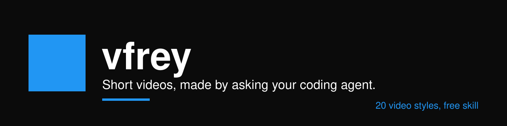

# vfrey skill

Make short videos and research social media by asking your coding agent. The vfrey skill: scripts, scenes, captions, voice, music and renders on your own machine. This is the vfrey skill for Claude Code, Codex, Cursor, Gemini CLI and Grok. It tells the agent how to write the script, build the scenes, add captions, voice and music, and render the video on your own machine. It also runs vfrey search: creators, trends and competitors on TikTok, Instagram, YouTube and Reddit.

   

Version 1.0.0-beta.8. Generated from the vfrey release; do not edit by hand.

## Contents

- [Start in 30 seconds](#start-in-30-seconds)
- [Install](#install)
- [Style gallery](#style-gallery)
- [Downloads](#downloads)
- [Which agent folder do I unzip into](#which-agent-folder-do-i-unzip-into)
- [Try it](#try-it)
- [What you need](#what-you-need)
- [What is free](#what-is-free)
- [FAQ and troubleshooting](#faq-and-troubleshooting)
- [Docs and contact](#docs-and-contact)

## Start in 30 seconds

There are three ways to get the skills. They give you the same files, so pick the one that suits you.

1. **The skills installer (recommended).** In a terminal, run `npx skills add vfreyai/skills`. This is the open `skills` installer, not the vfrey command line, so it works before vfrey is installed. Add `--skill vfrey-style-pixel-art` for one style, or `--list` to see them all.
2. **From vfrey itself.** If you already use vfrey, `npx vfrey init` writes your project's skills, `npx vfrey skill install --agent <claude|codex|grok|cursor|gemini|all>` installs the vfrey skill, and the Kit tab of the dashboard uses the style skill that came with the project.
3. **A plain zip download, no npx.** Download a zip in [Downloads](#downloads), unzip it into your agent's skills folder and restart the agent. It never replaces the other two; it is for people who would rather not use npx.

Then restart your coding agent (Claude Code, Codex, Cursor, Gemini CLI or Grok) so it sees the skill, and ask: *Make me a 30-second explainer about how tides work.*

## Install

Pick the agent you use. Restart the agent after installing so it sees the skill.

| Agent | Install | Remove |
| --- | --- | --- |
| Any (Claude Code, Codex, Cursor, Gemini CLI, Grok) | `npx skills add vfreyai/skills` | `npx skills remove vfrey` |
| Claude Code plugin | `claude plugin marketplace add vfreyai/skills` then `claude plugin install vfrey@vfrey` | `claude plugin uninstall vfrey@vfrey` |
| Codex plugin | `codex plugin marketplace add vfreyai/skills` then `codex plugin add vfrey@vfrey` | `codex plugin remove vfrey@vfrey` |
| Cursor | `npx skills add vfreyai/skills -a cursor`, or copy this repository to `~/.cursor/plugins/local/vfrey` and reload the window | `npx skills remove vfrey` |
| Gemini CLI | `gemini extensions install https://github.com/vfreyai/skills` | `gemini extensions uninstall vfrey` |

A project that already uses vfrey gets the same skill from `npx vfrey skill install --agent <claude|codex|grok|cursor|gemini|all>`.

## Style gallery

A style is a look for your videos: the colours, the drawing, the camera and the music. vfrey makes every video in one style, and each style is its own small skill (`vfrey-style-<name>`) that you can install on its own, without the rest of vfrey. Each one says so at the top: if vfrey is not installed, your agent offers to install it first, so a style installed alone still works. Click a picture to open the style's folder, with its full preview video.

<table>
<tr>
<td align="center" valign="top" width="25%">
 
<b>2D flat</b> 
Friendly cartoon people, bold flat colours and charts that grow as the voice explains. 
<code>npx skills add vfreyai/skills --skill vfrey-style-flat-2d</code> 
<a href="https://github.com/vfreyai/skills/releases/latest/download/vfrey-style-flat-2d.zip"><b>Download .zip</b></a>
</td>
<td align="center" valign="top" width="25%">
 
<b>Storybook watercolour</b> 
A hand-painted picture book with soft watercolour pages that turn, a paper caption strip and a gentle lullaby. 
<code>npx skills add vfreyai/skills --skill vfrey-style-storybook</code> 
<a href="https://github.com/vfreyai/skills/releases/latest/download/vfrey-style-storybook.zip"><b>Download .zip</b></a>
</td>
<td align="center" valign="top" width="25%">
<a href="skills/vfrey-style-paper-cutout">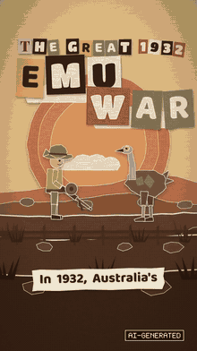</a> 
<b>Paper cut-out</b> 
Scenes made of layered cut and torn paper, with puppets that move like stop-motion and titles of cut-out letters. 
<code>npx skills add vfreyai/skills --skill vfrey-style-paper-cutout</code> 
<a href="https://github.com/vfreyai/skills/releases/latest/download/vfrey-style-paper-cutout.zip"><b>Download .zip</b></a>
</td>
<td align="center" valign="top" width="25%">
 
<b>Comic halftone</b> 
A comic page that comes alive, with bold ink outlines, dotted shading, panels that smash in and loud sound-effect lettering. 
<code>npx skills add vfreyai/skills --skill vfrey-style-comic-halftone</code> 
<a href="https://github.com/vfreyai/skills/releases/latest/download/vfrey-style-comic-halftone.zip"><b>Download .zip</b></a>
</td>
</tr>
<tr>
<td align="center" valign="top" width="25%">
<a href="skills/vfrey-style-whiteboard-sketch">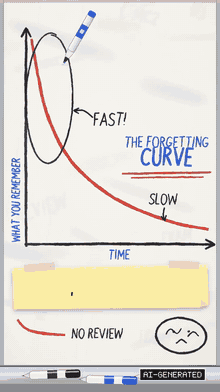</a> 
<b>Whiteboard sketch</b> 
A marker draws everything live on a whiteboard, with hand lettering, doodles, arrows and eraser wipes. 
<code>npx skills add vfreyai/skills --skill vfrey-style-whiteboard-sketch</code> 
<a href="https://github.com/vfreyai/skills/releases/latest/download/vfrey-style-whiteboard-sketch.zip"><b>Download .zip</b></a>
</td>
<td align="center" valign="top" width="25%">
 
<b>One-line minimal</b> 
One unbroken ink line draws each idea in turn on warm paper, then flows on into the next. Calm and hypnotic. 
<code>npx skills add vfreyai/skills --skill vfrey-style-one-line</code> 
<a href="https://github.com/vfreyai/skills/releases/latest/download/vfrey-style-one-line.zip"><b>Download .zip</b></a>
</td>
<td align="center" valign="top" width="25%">
<a href="skills/vfrey-style-soft-gradient">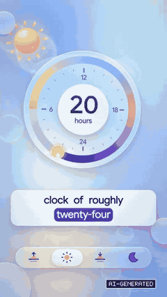</a> 
<b>Soft gradient</b> 
Drifting pastel colour fields with frosted glass cards and glossy icons that float in gently. 
<code>npx skills add vfreyai/skills --skill vfrey-style-soft-gradient</code> 
<a href="https://github.com/vfreyai/skills/releases/latest/download/vfrey-style-soft-gradient.zip"><b>Download .zip</b></a>
</td>
<td align="center" valign="top" width="25%">
<a href="skills/vfrey-style-real-3d">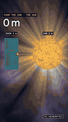</a> 
<b>Real 3D</b> 
A real 3D camera flying between glowing, lit objects in deep space, like a science documentary. 
<code>npx skills add vfreyai/skills --skill vfrey-style-real-3d</code> 
<a href="https://github.com/vfreyai/skills/releases/latest/download/vfrey-style-real-3d.zip"><b>Download .zip</b></a>
</td>
</tr>
<tr>
<td align="center" valign="top" width="25%">
 
<b>Low-poly 3D</b> 
A bright toy world made of flat coloured triangles, filmed by a camera that glides around a floating diorama. 
<code>npx skills add vfreyai/skills --skill vfrey-style-low-poly</code> 
<a href="https://github.com/vfreyai/skills/releases/latest/download/vfrey-style-low-poly.zip"><b>Download .zip</b></a>
</td>
<td align="center" valign="top" width="25%">
<a href="skills/vfrey-style-isometric">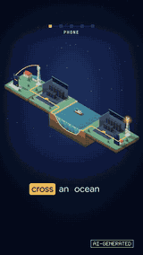</a> 
<b>Isometric miniature world</b> 
A tiny model world seen from above, with a glowing dot that travels through it as the voice explains. 
<code>npx skills add vfreyai/skills --skill vfrey-style-isometric</code> 
<a href="https://github.com/vfreyai/skills/releases/latest/download/vfrey-style-isometric.zip"><b>Download .zip</b></a>
</td>
<td align="center" valign="top" width="25%">
 
<b>Map documentary</b> 
A hand-inked atlas the camera glides over, where a route draws itself and the flat map folds into a globe. 
<code>npx skills add vfreyai/skills --skill vfrey-style-map-documentary</code> 
<a href="https://github.com/vfreyai/skills/releases/latest/download/vfrey-style-map-documentary.zip"><b>Download .zip</b></a>
</td>
<td align="center" valign="top" width="25%">
<a href="skills/vfrey-style-data-story">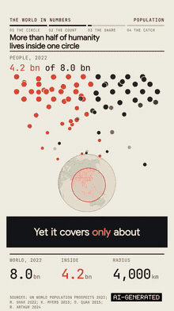</a> 
<b>Data story</b> 
Animated maps and charts like a newspaper data desk, with counting numbers and dots that regroup into bars. 
<code>npx skills add vfreyai/skills --skill vfrey-style-data-story</code> 
<a href="https://github.com/vfreyai/skills/releases/latest/download/vfrey-style-data-story.zip"><b>Download .zip</b></a>
</td>
</tr>
<tr>
<td align="center" valign="top" width="25%">
 
<b>Screen demo</b> 
A clean, light fake app on screen where a cursor clicks and zooms in on the exact detail the voice is explaining. 
<code>npx skills add vfreyai/skills --skill vfrey-style-screen-demo</code> 
<a href="https://github.com/vfreyai/skills/releases/latest/download/vfrey-style-screen-demo.zip"><b>Download .zip</b></a>
</td>
<td align="center" valign="top" width="25%">
<a href="skills/vfrey-style-blueprint">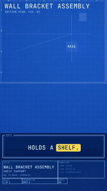</a> 
<b>Blueprint</b> 
A drafted engineering sheet on blueprint blue, drawn line by line, with colour-coded arrows showing how it works. 
<code>npx skills add vfreyai/skills --skill vfrey-style-blueprint</code> 
<a href="https://github.com/vfreyai/skills/releases/latest/download/vfrey-style-blueprint.zip"><b>Download .zip</b></a>
</td>
<td align="center" valign="top" width="25%">
 
<b>Terminal / ASCII</b> 
A glowing old-school computer screen where everything is typed and drawn from text characters. 
<code>npx skills add vfreyai/skills --skill vfrey-style-terminal</code> 
<a href="https://github.com/vfreyai/skills/releases/latest/download/vfrey-style-terminal.zip"><b>Download .zip</b></a>
</td>
<td align="center" valign="top" width="25%">
<a href="skills/vfrey-style-kinetic-type">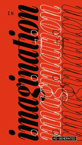</a> 
<b>Kinetic type</b> 
Huge words that fill the screen and move with the voice, like the opening titles of a film. 
<code>npx skills add vfreyai/skills --skill vfrey-style-kinetic-type</code> 
<a href="https://github.com/vfreyai/skills/releases/latest/download/vfrey-style-kinetic-type.zip"><b>Download .zip</b></a>
</td>
</tr>
<tr>
<td align="center" valign="top" width="25%">
<a href="skills/vfrey-style-pixel-art">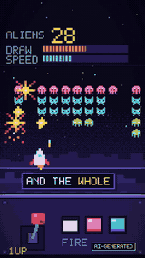</a> 
<b>Pixel art</b> 
A retro video game look with chunky pixels, little animated characters and chiptune music. 
<code>npx skills add vfreyai/skills --skill vfrey-style-pixel-art</code> 
<a href="https://github.com/vfreyai/skills/releases/latest/download/vfrey-style-pixel-art.zip"><b>Download .zip</b></a>
</td>
<td align="center" valign="top" width="25%">
<a href="skills/vfrey-style-neon-synthwave">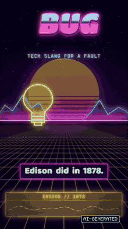</a> 
<b>Neon synthwave</b> 
Glowing neon line drawings on a purple night sky with a striped sun, a drifting grid floor and VHS glitches. 
<code>npx skills add vfreyai/skills --skill vfrey-style-neon-synthwave</code> 
<a href="https://github.com/vfreyai/skills/releases/latest/download/vfrey-style-neon-synthwave.zip"><b>Download .zip</b></a>
</td>
<td align="center" valign="top" width="25%">
 
<b>Vintage newspaper</b> 
A yellowed old newspaper page where headlines are stamped in and the engraved pictures come alive, story by story. 
<code>npx skills add vfreyai/skills --skill vfrey-style-vintage-newspaper</code> 
<a href="https://github.com/vfreyai/skills/releases/latest/download/vfrey-style-vintage-newspaper.zip"><b>Download .zip</b></a>
</td>
<td align="center" valign="top" width="25%">
 
<b>Silhouette noir</b> 
Dark, foggy scenes of black shapes lit by one warm light, like the opening of a mystery film. 
<code>npx skills add vfreyai/skills --skill vfrey-style-noir</code> 
<a href="https://github.com/vfreyai/skills/releases/latest/download/vfrey-style-noir.zip"><b>Download .zip</b></a>
</td>
</tr>
</table>

Previews of all 20 are on https://vfrey.ai/examples.

### Install one style alone

Replace `vfrey-style-pixel-art` with any skill name from the gallery.

| Agent | Install one style | Remove |
| --- | --- | --- |
| Any (Claude Code, Codex, Cursor, Gemini CLI, Grok) | `npx skills add vfreyai/skills --skill vfrey-style-pixel-art` | `npx skills remove vfrey-style-pixel-art` |
| One agent only | `npx skills add vfreyai/skills --skill vfrey-style-pixel-art -a claude-code` (also `codex`, `cursor`, `gemini-cli`) | `npx skills remove vfrey-style-pixel-art -a claude-code` |
| Claude Code, Codex, Gemini CLI plugins | These install the whole repository, so you get every style together with vfrey. To get only one, use the row above. | |
| Copy by hand | Use a zip from [Downloads](#downloads), or copy the folder from https://github.com/vfreyai/skills/tree/main/skills into your agent's skills folder, for example `.claude/skills/` | Delete the folder |

To install several: `npx skills add vfreyai/skills --skill vfrey-style-pixel-art --skill vfrey-style-noir`. To see the list: `npx skills add vfreyai/skills --list`.

A project that already uses vfrey picks a style in the Kit tab of the dashboard; the style skills come with the project.

## Downloads

Prefer a file to a command? Each download is a zip of ready skill folders. Links always point to the newest release.

| Download | What is inside | Skills |
| --- | --- | --- |
| [vfrey-complete.zip](https://github.com/vfreyai/skills/releases/latest/download/vfrey-complete.zip) | Complete: The vfrey skill and all 20 styles. | 21 |
| [vfrey-styles-all.zip](https://github.com/vfreyai/skills/releases/latest/download/vfrey-styles-all.zip) | All styles: All 20 styles, without the vfrey skill. | 20 |
| [vfrey-bundle-illustrated.zip](https://github.com/vfreyai/skills/releases/latest/download/vfrey-bundle-illustrated.zip) | Illustrated: Drawn, painted and cut-paper looks. 7 styles. | 7 |
| [vfrey-bundle-3d.zip](https://github.com/vfreyai/skills/releases/latest/download/vfrey-bundle-3d.zip) | 3D and worlds: Cameras that fly through lit objects, toy worlds and maps. 4 styles. | 4 |
| [vfrey-bundle-data.zip](https://github.com/vfreyai/skills/releases/latest/download/vfrey-bundle-data.zip) | Data and explainers: Charts, screens, drafting sheets and big moving words. 5 styles. | 5 |
| [vfrey-bundle-retro.zip](https://github.com/vfreyai/skills/releases/latest/download/vfrey-bundle-retro.zip) | Retro and moody: Pixels, neon, old newsprint and dark mystery. 4 styles. | 4 |

The 20 single styles are in the [Style gallery](#style-gallery), each with its own **Download .zip** link (`vfrey-style-<name>.zip`).

The themed bundles:

- **Illustrated** (7): `flat-2d`, `storybook`, `paper-cutout`, `comic-halftone`, `whiteboard-sketch`, `one-line`, `soft-gradient`
- **3D and worlds** (4): `real-3d`, `low-poly`, `isometric`, `map-documentary`
- **Data and explainers** (5): `data-story`, `screen-demo`, `blueprint`, `terminal`, `kinetic-type`
- **Retro and moody** (4): `pixel-art`, `neon-synthwave`, `vintage-newspaper`, `noir`

Not sure? Take [vfrey-complete.zip](https://github.com/vfreyai/skills/releases/latest/download/vfrey-complete.zip): it has everything. Each zip holds whole skill folders (such as `vfrey-style-pixel-art/`), so unzipping into your agent's skills folder just works. To check a download, put it next to [SHA256SUMS.txt](https://github.com/vfreyai/skills/releases/latest/download/SHA256SUMS.txt) and run `shasum -a 256 -c SHA256SUMS.txt --ignore-missing`.

### Install from a zip

1. Download the zip (click a link above, or `curl -L -o vfrey-style-pixel-art.zip https://github.com/vfreyai/skills/releases/latest/download/vfrey-style-pixel-art.zip`).
2. Unzip it into your agent's skills folder. On a Mac or Linux you can do it from a terminal; on Windows, right-click the zip, choose Extract All and pick the folder (`~` is your home folder).
3. Restart the agent. A style alone asks to install vfrey the first time; vfrey-complete.zip already includes it.

| Agent | Terminal command (example: Pixel art) | Your personal skills folder |
| --- | --- | --- |
| Claude Code | `unzip ~/Downloads/vfrey-style-pixel-art.zip -d ~/.claude/skills/` | `~/.claude/skills/` |
| Codex | `unzip ~/Downloads/vfrey-style-pixel-art.zip -d ~/.agents/skills/` | `~/.agents/skills/` |
| Cursor | `unzip ~/Downloads/vfrey-style-pixel-art.zip -d ~/.agents/skills/` | `~/.agents/skills/` |
| Gemini CLI | `unzip ~/Downloads/vfrey-style-pixel-art.zip -d ~/.agents/skills/` | `~/.agents/skills/` |
| Grok | `unzip ~/Downloads/vfrey-style-pixel-art.zip -d ~/.agents/skills/` | `~/.agents/skills/` |

To use a skill in one project only, unzip into the agent's project folder instead (for example `.claude/skills/` or `.agents/skills/` inside the project); the table below lists both. Other agents: see `skills/vfrey/agents.md`.

## Which agent folder do I unzip into

The folders each agent reads, from `skills/vfrey/agents.md`. A project folder only affects that project; the `~` folder affects all of your work.

| Agent | Skills folder | After unzipping |
| --- | --- | --- |
| Claude Code | `.claude/skills/` (project) or `~/.claude/skills/` | Restart Claude Code. Plugin skills are namespaced as `vfrey:vfrey`. |
| Codex | `.agents/skills/` (project) or `~/.agents/skills/` | Codex picks up skills live; a plugin needs `codex plugin add`. |
| Cursor | `.agents/skills/` (project) or `~/.agents/skills/` (Cursor also reads `.cursor/skills/`) | Restart Cursor, or run Developer: Reload Window. |
| Gemini CLI | `.agents/skills/` (project) or `~/.agents/skills/` (the alias of `.gemini/skills/`) | Run `/skills reload` in Gemini CLI; an extension needs a restart. |
| Grok | `.agents/skills/` (project) or `~/.agents/skills/` (Grok also reads `.grok/skills/`) | Grok picks it up live. |
| Antigravity | `.agents/skills/` (project) or `~/.gemini/config/skills/` | Start a new conversation; in the CLI (`agy`) run `/skills reload`. |
| Kiro | `.kiro/skills/` (project, a link to the `.agents/skills` copy) or `~/.kiro/skills/` | Start a new session. |
| Cline | `.cline/skills/` (project, a link) or `~/.cline/skills/` | Cline picks it up by itself. |
| Continue | `.continue/skills/` (project, a link) or `~/.continue/skills/` | Restart Continue or `cn`. |
| Qwen Code, Junie, Augment (Auggie), GitHub Copilot, Roo Code, Kilo Code, OpenCode, goose, Amp, Zed, Crush, Factory Droid, Warp, Devin (Windsurf) | `.agents/skills/` (project) or `~/.agents/skills/` | Start a new session (Copilot CLI: `/skills reload`; Kilo Code: `/reload`; Qwen Code and Zed pick it up live). |

## Try it

Open any folder and ask your agent:

> Make me a 30-second explainer about how tides work.

If the folder has no vfrey project yet, the agent offers to create one and asks you first. Research needs no project:

> Find TikTok creators in Vietnam who review skincare.

The agent prices the search first and waits for your yes before it spends any credits.

## What you need

- Node 22.13 or newer
- ffmpeg on your PATH

The skill runs the vfrey command line for you (`npx @vfrey/vfrey` the first time). Check the machine any time with `npx @vfrey/vfrey doctor`.

## What is free

The skill, the command line and rendering on your own machine are free. You pay only for the services you choose to connect, such as a voice or model provider, with your own keys, and for vfrey search and cloud features, which use credits and always ask first.

## FAQ and troubleshooting

**My agent does not see the skill.** Restart the agent; the table above says what each one needs after installing. Then check that the folder is named exactly like the skill (`vfrey-style-pixel-art`) and holds a `SKILL.md`.

**What is installed?** Run `npx skills list`, or `npx skills add vfreyai/skills --list` to see everything this repository offers.

**How do I update?** Run `npx skills update`. With a zip, download the new one and unzip it over the old folder.

**How do I remove one?** `npx skills remove vfrey-style-pixel-art`, or delete the folder.

**A style asks me to install vfrey.** That is expected: a style is a look, vfrey does the work. Install the vfrey skill too, or take vfrey-complete.zip.

**Do the zips include the preview videos?** No, only what the agent reads, which keeps them small. The previews are in each style's folder here.

**Something is wrong or missing.** Open an issue: https://github.com/vfreyai/skills/issues/new/choose. This repository is generated, so fixes happen in vfrey itself; see [CONTRIBUTING.md](CONTRIBUTING.md).

## Docs and contact

- Quickstart: https://vfrey.ai/docs/quickstart
- Website and video previews: https://vfrey.ai
- Issues and style requests: https://github.com/vfreyai/skills/issues/new/choose
- How each agent loads the skill: `skills/vfrey/agents.md`
