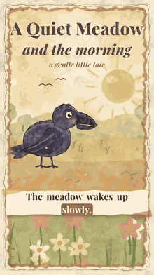
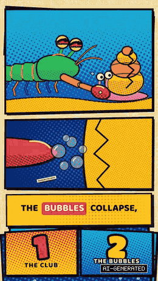
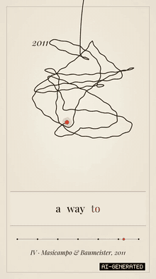
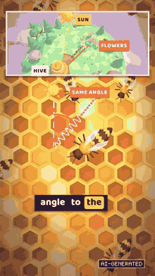
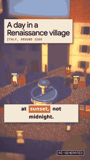
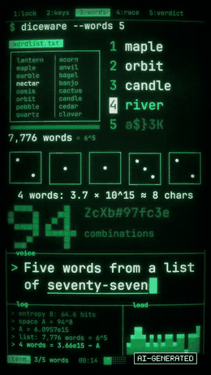
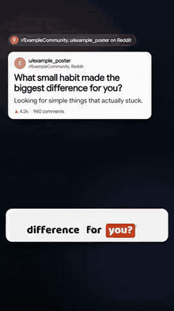
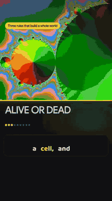
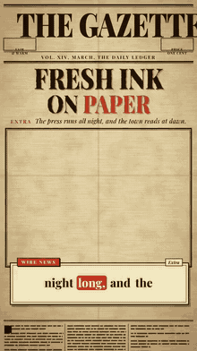
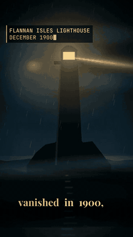

# vfrey skill

Make short videos and research social media by asking your coding agent. This is the vfrey skill for Claude Code, Codex, Cursor, Gemini CLI and Grok. It tells the agent how to write the script, build the scenes, add captions, voice and music, and render the video on your own machine. It also runs vfrey search: creators, trends and competitors on TikTok, Instagram, YouTube and Reddit.

Version 1.0.0-beta.8. Generated from the vfrey release; do not edit by hand.

## Install

Three ways to get the same skills. Restart your agent after installing so it sees them.

| Way | Install | Remove |
| --- | --- | --- |
| The skills installer (any agent: Claude Code, Codex, Cursor, Gemini CLI, Grok; works before vfrey is installed) | `npx skills add vfreyai/skills`. One style: add `--skill vfrey-style-pixel-art`. See the list: add `--list`. | `npx skills remove vfrey` |
| From vfrey itself | `npx vfrey init` writes a project's skills; `npx vfrey skill install --agent claude` installs the vfrey skill (also `codex`, `grok`, `cursor`, `gemini`, `all`). The Kit tab of the dashboard picks a style from the ones that came with the project. | `npx vfrey skill uninstall` |
| A zip, no npx | Download a zip from [Downloads](#downloads), unzip it into your agent's skills folder and restart the agent. | Delete the folder |

Plugins: `claude plugin marketplace add vfreyai/skills` then `claude plugin install vfrey@vfrey` (Claude Code); `codex plugin marketplace add vfreyai/skills` then `codex plugin add vfrey@vfrey` (Codex); `gemini extensions install https://github.com/vfreyai/skills` (Gemini CLI). Cursor: `npx skills add vfreyai/skills -a cursor`. Plugins install the whole repository, so you get every style together with vfrey.

## Styles

A style is a look for your videos: the colours, the drawing, the camera and the music. vfrey makes every video in one style, and each style is its own small skill (`vfrey-style-<name>`) that you can install on its own, without the rest of vfrey. If vfrey is not installed, your agent offers to install it first, so a style installed alone still works. Click a picture to play the full preview video. All 23 are also on https://vfrey.ai/render/showcase.

To see them all: `npx skills add vfreyai/skills --list`.

<table>
<tr>
<td align="center" valign="top" width="33%"> <b>2D flat</b> Friendly cartoon people, bold flat colours and charts that grow as the voice explains. <code>npx skills add vfreyai/skills --skill vfrey-style-flat-2d</code> <a href="https://github.com/vfreyai/skills/releases/latest/download/vfrey-style-flat-2d.zip">Download .zip</a></td>
<td align="center" valign="top" width="33%"> <b>Storybook watercolour</b> A hand-painted picture book with soft watercolour pages that turn, a paper caption strip and a gentle lullaby. <code>npx skills add vfreyai/skills --skill vfrey-style-storybook</code> <a href="https://github.com/vfreyai/skills/releases/latest/download/vfrey-style-storybook.zip">Download .zip</a></td>
<td align="center" valign="top" width="33%"> <b>Paper cut-out</b> Scenes made of layered cut and torn paper, with puppets that move like stop-motion and titles of cut-out letters. <code>npx skills add vfreyai/skills --skill vfrey-style-paper-cutout</code> <a href="https://github.com/vfreyai/skills/releases/latest/download/vfrey-style-paper-cutout.zip">Download .zip</a></td>
</tr>
<tr>
<td align="center" valign="top" width="33%"> <b>Comic halftone</b> A comic page that comes alive, with bold ink outlines, dotted shading, panels that smash in and loud sound-effect lettering. <code>npx skills add vfreyai/skills --skill vfrey-style-comic-halftone</code> <a href="https://github.com/vfreyai/skills/releases/latest/download/vfrey-style-comic-halftone.zip">Download .zip</a></td>
<td align="center" valign="top" width="33%"> <b>Whiteboard sketch</b> A marker draws everything live on a whiteboard, with hand lettering, doodles, arrows and eraser wipes. <code>npx skills add vfreyai/skills --skill vfrey-style-whiteboard-sketch</code> <a href="https://github.com/vfreyai/skills/releases/latest/download/vfrey-style-whiteboard-sketch.zip">Download .zip</a></td>
<td align="center" valign="top" width="33%"> <b>One-line minimal</b> One unbroken ink line draws each idea in turn on warm paper, then flows on into the next. Calm and hypnotic. <code>npx skills add vfreyai/skills --skill vfrey-style-one-line</code> <a href="https://github.com/vfreyai/skills/releases/latest/download/vfrey-style-one-line.zip">Download .zip</a></td>
</tr>
<tr>
<td align="center" valign="top" width="33%"> <b>Soft gradient</b> Drifting pastel colour fields with frosted glass cards and glossy icons that float in gently. <code>npx skills add vfreyai/skills --skill vfrey-style-soft-gradient</code> <a href="https://github.com/vfreyai/skills/releases/latest/download/vfrey-style-soft-gradient.zip">Download .zip</a></td>
<td align="center" valign="top" width="33%"> <b>Real 3D</b> A real 3D camera flying between glowing, lit objects in deep space, like a science documentary. <code>npx skills add vfreyai/skills --skill vfrey-style-real-3d</code> <a href="https://github.com/vfreyai/skills/releases/latest/download/vfrey-style-real-3d.zip">Download .zip</a></td>
<td align="center" valign="top" width="33%"> <b>Low-poly 3D</b> A bright toy world made of flat coloured triangles, filmed by a camera that glides around a floating diorama. <code>npx skills add vfreyai/skills --skill vfrey-style-low-poly</code> <a href="https://github.com/vfreyai/skills/releases/latest/download/vfrey-style-low-poly.zip">Download .zip</a></td>
</tr>
<tr>
<td align="center" valign="top" width="33%"> <b>Isometric miniature world</b> A tiny model world seen from above, with a glowing dot that travels through it as the voice explains. <code>npx skills add vfreyai/skills --skill vfrey-style-isometric</code> <a href="https://github.com/vfreyai/skills/releases/latest/download/vfrey-style-isometric.zip">Download .zip</a></td>
<td align="center" valign="top" width="33%"> <b>Map documentary</b> A hand-inked atlas the camera glides over, where a route draws itself and the flat map folds into a globe. <code>npx skills add vfreyai/skills --skill vfrey-style-map-documentary</code> <a href="https://github.com/vfreyai/skills/releases/latest/download/vfrey-style-map-documentary.zip">Download .zip</a></td>
<td align="center" valign="top" width="33%"> <b>2.5D Diorama</b> Pixel-art characters in a lit 3D miniature town, with long sun shadows, a tilt-shift blur and a slow camera move. <code>npx skills add vfreyai/skills --skill vfrey-style-parallax-25d</code> <a href="https://github.com/vfreyai/skills/releases/latest/download/vfrey-style-parallax-25d.zip">Download .zip</a></td>
</tr>
<tr>
<td align="center" valign="top" width="33%"> <b>Data story</b> Animated maps and charts like a newspaper data desk, with counting numbers and dots that regroup into bars. <code>npx skills add vfreyai/skills --skill vfrey-style-data-story</code> <a href="https://github.com/vfreyai/skills/releases/latest/download/vfrey-style-data-story.zip">Download .zip</a></td>
<td align="center" valign="top" width="33%"> <b>Screen demo</b> A clean, light fake app on screen where a cursor clicks and zooms in on the exact detail the voice is explaining. <code>npx skills add vfreyai/skills --skill vfrey-style-screen-demo</code> <a href="https://github.com/vfreyai/skills/releases/latest/download/vfrey-style-screen-demo.zip">Download .zip</a></td>
<td align="center" valign="top" width="33%"> <b>Blueprint</b> A drafted engineering sheet on blueprint blue, drawn line by line, with colour-coded arrows showing how it works. <code>npx skills add vfreyai/skills --skill vfrey-style-blueprint</code> <a href="https://github.com/vfreyai/skills/releases/latest/download/vfrey-style-blueprint.zip">Download .zip</a></td>
</tr>
<tr>
<td align="center" valign="top" width="33%"> <b>Terminal / ASCII</b> A glowing old-school computer screen where everything is typed and drawn from text characters. <code>npx skills add vfreyai/skills --skill vfrey-style-terminal</code> <a href="https://github.com/vfreyai/skills/releases/latest/download/vfrey-style-terminal.zip">Download .zip</a></td>
<td align="center" valign="top" width="33%"> <b>Kinetic type</b> Huge words that fill the screen and move with the voice, like the opening titles of a film. <code>npx skills add vfreyai/skills --skill vfrey-style-kinetic-type</code> <a href="https://github.com/vfreyai/skills/releases/latest/download/vfrey-style-kinetic-type.zip">Download .zip</a></td>
<td align="center" valign="top" width="33%"> <b>Post and comments</b> A public Reddit or Threads post and its top comments as clean cards, read aloud with captions and credited on screen. <code>npx skills add vfreyai/skills --skill vfrey-style-post-comments</code> <a href="https://github.com/vfreyai/skills/releases/latest/download/vfrey-style-post-comments.zip">Download .zip</a></td>
</tr>
<tr>
<td align="center" valign="top" width="33%"> <b>Footage split</b> Your own footage in one half of a split screen (or behind everything), the key point and captions in the other. <code>npx skills add vfreyai/skills --skill vfrey-style-footage-split</code> <a href="https://github.com/vfreyai/skills/releases/latest/download/vfrey-style-footage-split.zip">Download .zip</a></td>
<td align="center" valign="top" width="33%"> <b>Pixel art</b> A retro video game look with chunky pixels, little animated characters and chiptune music. <code>npx skills add vfreyai/skills --skill vfrey-style-pixel-art</code> <a href="https://github.com/vfreyai/skills/releases/latest/download/vfrey-style-pixel-art.zip">Download .zip</a></td>
<td align="center" valign="top" width="33%"> <b>Neon synthwave</b> Glowing neon line drawings on a purple night sky with a striped sun, a drifting grid floor and VHS glitches. <code>npx skills add vfreyai/skills --skill vfrey-style-neon-synthwave</code> <a href="https://github.com/vfreyai/skills/releases/latest/download/vfrey-style-neon-synthwave.zip">Download .zip</a></td>
</tr>
<tr>
<td align="center" valign="top" width="33%"> <b>Vintage newspaper</b> A yellowed old newspaper page where headlines are stamped in and the engraved pictures come alive, story by story. <code>npx skills add vfreyai/skills --skill vfrey-style-vintage-newspaper</code> <a href="https://github.com/vfreyai/skills/releases/latest/download/vfrey-style-vintage-newspaper.zip">Download .zip</a></td>
<td align="center" valign="top" width="33%"> <b>Silhouette noir</b> Dark, foggy scenes of black shapes lit by one warm light, like the opening of a mystery film. <code>npx skills add vfreyai/skills --skill vfrey-style-noir</code> <a href="https://github.com/vfreyai/skills/releases/latest/download/vfrey-style-noir.zip">Download .zip</a></td>
</tr>
</table>

The showcase at https://vfrey.ai/render/showcase has 27 films: 22 use a style above, 5 are one-off looks the agent drew from scratch.

### About the sample films

The sample films and previews here were made by AI agents, mostly Claude Sonnet 5.5 at medium effort. Some were remade or edited by Claude Opus 5.5, and a few mix models; the showcase page credits each film: https://vfrey.ai/render/showcase. The result depends on the model your own agent runs and on the style, so yours can be better or worse than these.

## Downloads

- [vfrey-complete.zip](https://github.com/vfreyai/skills/releases/latest/download/vfrey-complete.zip): The vfrey skill and all 23 styles.
- [vfrey-styles-all.zip](https://github.com/vfreyai/skills/releases/latest/download/vfrey-styles-all.zip): All 23 styles, without the vfrey skill.
- [vfrey-bundle-illustrated.zip](https://github.com/vfreyai/skills/releases/latest/download/vfrey-bundle-illustrated.zip): Drawn, painted and cut-paper looks. 7 styles.
- [vfrey-bundle-3d.zip](https://github.com/vfreyai/skills/releases/latest/download/vfrey-bundle-3d.zip): Cameras that fly through lit objects, toy worlds and maps. 5 styles.
- [vfrey-bundle-data.zip](https://github.com/vfreyai/skills/releases/latest/download/vfrey-bundle-data.zip): Charts, screens, drafting sheets and big moving words. 5 styles.
- [vfrey-bundle-social.zip](https://github.com/vfreyai/skills/releases/latest/download/vfrey-bundle-social.zip): Reddit and Threads posts, and your own footage. 2 styles.
- [vfrey-bundle-retro.zip](https://github.com/vfreyai/skills/releases/latest/download/vfrey-bundle-retro.zip): Pixels, neon, old newsprint and dark mystery. 4 styles.
- [SHA256SUMS.txt](https://github.com/vfreyai/skills/releases/latest/download/SHA256SUMS.txt): check a file with `shasum -a 256 -c SHA256SUMS.txt --ignore-missing`

The 23 single styles are the Download .zip links above. Unzip into your agent's skills folder (a project's, or your home folder's, below) so each skill keeps its own folder, then restart the agent.

| Agent | Skills folder | After unzipping |
| --- | --- | --- |
| Claude Code | `.claude/skills/` (project) or `~/.claude/skills/` | Restart Claude Code. Plugin skills are namespaced as `vfrey:vfrey`. |
| Codex | `.agents/skills/` (project) or `~/.agents/skills/` | Codex picks up skills live; a plugin needs `codex plugin add`. |
| Cursor | `.agents/skills/` (project) or `~/.agents/skills/` (Cursor also reads `.cursor/skills/`) | Restart Cursor, or run Developer: Reload Window. |
| Gemini CLI | `.agents/skills/` (project) or `~/.agents/skills/` (the alias of `.gemini/skills/`) | Run `/skills reload` in Gemini CLI; an extension needs a restart. |
| Grok | `.agents/skills/` (project) or `~/.agents/skills/` (Grok also reads `.grok/skills/`) | Grok picks it up live. |
| Antigravity | `.agents/skills/` (project) or `~/.gemini/config/skills/` | Start a new conversation; in the CLI (`agy`) run `/skills reload`. |
| Kiro | `.kiro/skills/` (project, a link to the `.agents/skills` copy) or `~/.kiro/skills/` | Start a new session. |
| Cline | `.cline/skills/` (project, a link) or `~/.cline/skills/` | Cline picks it up by itself. |
| Continue | `.continue/skills/` (project, a link) or `~/.continue/skills/` | Restart Continue or `cn`. |
| Qwen Code, Junie, Augment (Auggie), GitHub Copilot, Roo Code, Kilo Code, OpenCode, goose, Amp, Zed, Crush, Factory Droid, Warp, Devin (Windsurf) | `.agents/skills/` (project) or `~/.agents/skills/` | Start a new session (Copilot CLI: `/skills reload`; Kilo Code: `/reload`; Qwen Code and Zed pick it up live). |

## What you need

- Node 22.13 or newer
- ffmpeg on your PATH

The skill runs the vfrey command line for you (`npx @vfrey/vfrey` the first time). Check the machine any time with `npx @vfrey/vfrey doctor`.

## What is free

The skill, the command line and rendering on your own machine are free. You pay only for the services you choose to connect, such as a voice or model provider, with your own keys, and for vfrey search and cloud features, which use credits and always ask first.

## Docs

https://vfrey.ai/docs/quickstart
